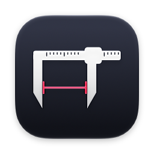
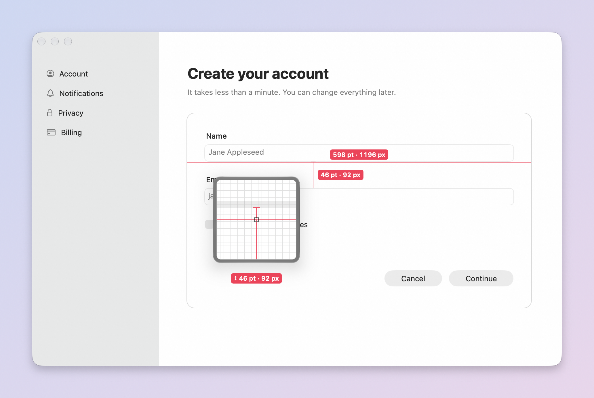
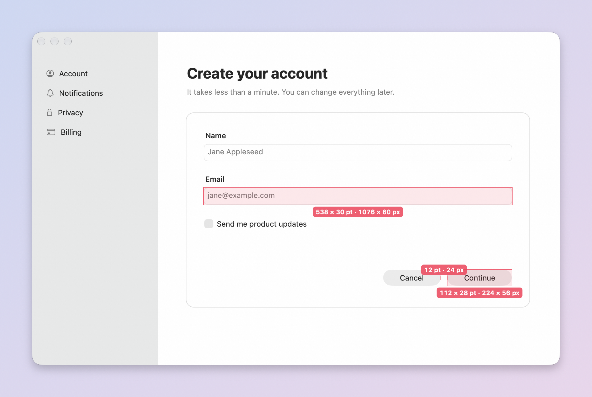
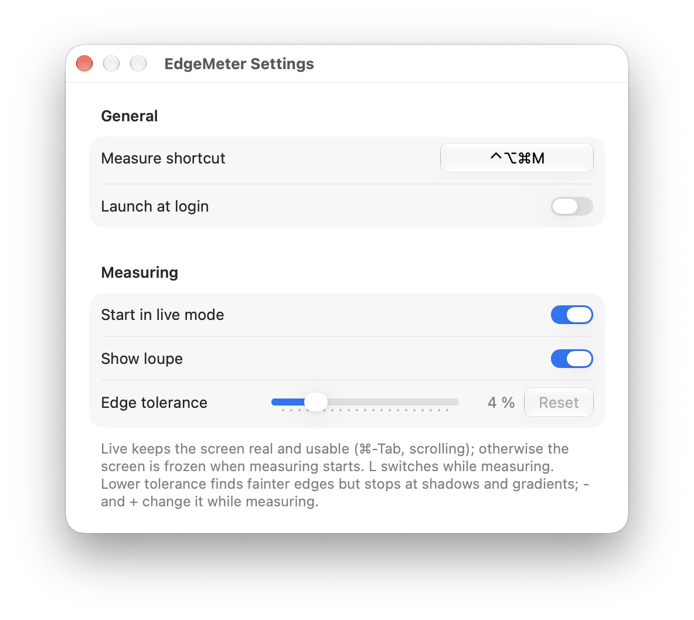

<p align="center">
  
</p>

<h1 align="center">EdgeMeter</h1>

<p align="center">
  Measure anything on your Mac's screen – pixel-exact, snapped to the edges you see.<br>
  Free and open source. An alternative to PixelSnap.
</p>

<p align="center">
  <a href="https://github.com/Limatationz/EdgeMeter/releases/latest"><b>Download</b></a> ·
  <a href="#keys">Keys</a> ·
  <a href="https://github.com/Limatationz/EdgeMeter/issues">Feedback</a> ·
  <a href="CONTRIBUTING.md">Contributing</a>
</p>



## Features

- **Hover** – distances from the cursor to the nearest edges in all four directions, live as you move.
- **Two points** – drag a line between two edges; both ends snap to the nearest edge.
- **Objects** – click a button, icon or card to get its exact size.
- **Areas** – drag roughly around something, the box snaps to its edges.
- **Loupe** – the exact pixels around the cursor, magnified, with the measurement drawn in.
- **Pixel nudging** – arrow keys move by one device pixel (⇧ for ten).
- **Points and pixels** – on Retina displays every value shows both, e.g. `100 pt · 200 px`.
- **Live** – measures the real screen while it moves; freeze it with **L** for menus and animations.
- **Copy** – ⌘C puts the value on the clipboard; pin as many measurements as you like.
- Native and light: a menu-bar app, under 10 % of one core while measuring live, nothing while idle.



## Install

1. Download `EdgeMeter-<version>.dmg` from the [latest release](https://github.com/Limatationz/EdgeMeter/releases/latest).
2. Drag EdgeMeter into Applications and open it. It's signed and notarized by Apple.
3. Allow **Screen Recording** when asked – the introduction walks you through it.

Requires macOS 14 Sonoma or later, Apple silicon or Intel.

### Privacy

EdgeMeter finds edges by reading the pixels on screen, which macOS only allows with the Screen
Recording permission. Pixels are only read in memory while you measure. Nothing is saved, recorded
or sent anywhere, and EdgeMeter makes no network connections. While measuring live, macOS shows its
purple recording indicator in the menu bar; it disappears when you press Esc.

## Usage

Press **⌃⌥⌘M** (or click the caliper in the menu bar › Measure), measure, press **Esc** to leave.
The shortcut can be changed in Settings.

<a id="keys"></a>

| Key | Action |
|---|---|
| **1 / 2 / 3 / 4** | Hover / two points / object / area |
| **Click** | Pin the hover measurement, or measure the clicked object (3) |
| **Drag** | Two-point line or area (2, 4) |
| **⌥** (hold) | Outside edges instead of inside (hover) |
| **⌘** (hold) | No snapping while dragging |
| **← → ↑ ↓** | Move by one pixel, **⇧** for ten – also moves the end of a drag |
| **Z** | Loupe on/off |
| **- / +** or **⌥-scroll** | Edge tolerance, when an edge is missed or found too early |
| **L** | Live / frozen |
| **S** | Scale: Auto, 1×, 2×, 3× |
| **⌘C / ⇧⌘C** | Copy current / all measurements |
| **⌘Z / ⇧⌘Z, ⌫** | Undo / redo, delete last |
| **X** | Clear all |
| **H** | Hide the help bar |
| **Esc** | Stop measuring |

Scrolling without ⌥ goes to the app underneath, so you can scroll while measuring.



## Feedback

Found a wrong measurement or have an idea? Choose **Send Feedback…** in EdgeMeter's menu – it opens a
[GitHub issue](https://github.com/Limatationz/EdgeMeter/issues/new/choose) with your versions filled in.
EdgeMeter only measures; screenshot and annotation features are out of scope.

## Building from source

```sh
brew install xcodegen
git clone https://github.com/Limatationz/EdgeMeter.git && cd EdgeMeter
xcodegen generate && open EdgeMeter.xcodeproj
```

Needs Xcode 26. See [CONTRIBUTING.md](CONTRIBUTING.md) for the project layout, tests and debug tools,
and [docs/FEATURES.md](docs/FEATURES.md) for the feature catalog and roadmap.

## License

[MIT](LICENSE) © 2026 Erik Rill
